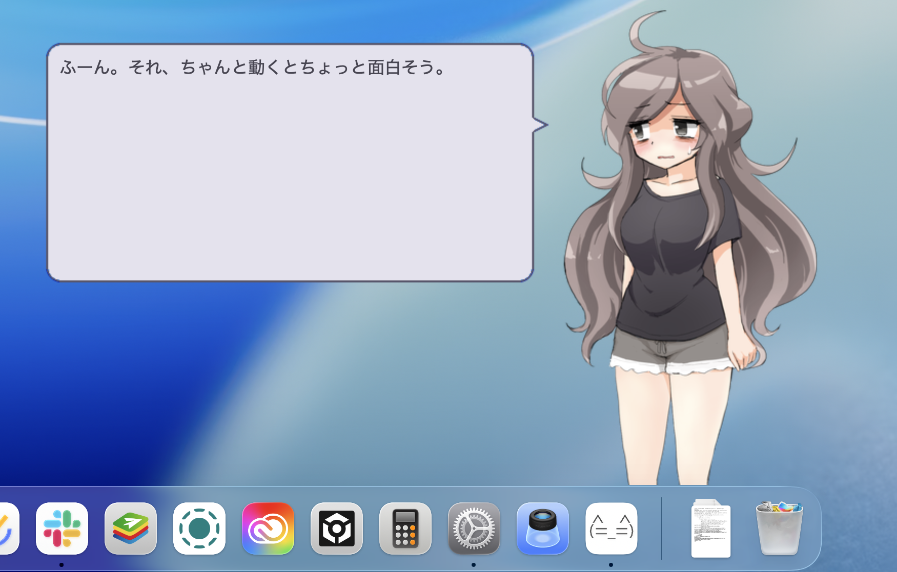

# Utatane / 転寝

Utataneは、伺かのゴーストをmacOSで動かすためのアプリです。

[公式サイト・ダウンロード](https://dl.wmsci.com/utatane/) · [使い方](https://dl.wmsci.com/utatane/docs/) · [変更履歴](CHANGELOG.md)

## インストール

1. [公式サイト](https://dl.wmsci.com/utatane/)からmacOS版をダウンロードする
2. DMGを開き、`Utatane.app`をApplicationsへドラッグする。ZIPの場合は展開して「アプリケーション」フォルダへ移動する
3. Utataneを起動し、画面の案内に従ってSHIORIモジュールを導入する

同梱ゴースト「りあ」とバルーン「Ria」が使えます。公式配布版はDeveloper ID署名・公証済みです。過去の版は[Releases](https://github.com/opera7133/Utatane/releases)から取得できます。

## 主な機能

- ゴーストとの会話、選択肢、マウス操作への反応
- シェル・バルーンの切り替え、着せ替え、アニメーション
- 複数ゴーストの起動、ウィンドウモード、発話履歴
- NARのインストール、SSPフォルダからの取り込み、コンテンツの更新・管理
- YAYA・里々・華和梨などのmacOS用SHIORI、SAORI、プラグインの利用
- 音声の読み上げ・認識、カレンダー、ヘッドライン、SSTPによる連携

日本語・英語・簡体字中国語・繁体字中国語・韓国語に対応しています。

## ゴーストを追加する

配布されているNARをUtataneへドラッグ＆ドロップして追加できます。展開済みのSSPフォルダから、ゴーストやバルーンを取り込むこともできます。詳しくは[コンテンツの管理](Docs/Guide/Content.md)を参照してください。

ゴーストが使うSHIORIや外部モジュールによって、動作する範囲が異なります。Windows向けのDLLやexeを使う場合は、対応するmacOS用モジュールやWineの設定が必要です。[互換性の確認](Docs/Support/Compatibility.md)と[SHIORI・SAORIの利用](Docs/Support/Native-SHIORI.md)を確認してください。

## 関連リンク

- [ドキュメント一覧](Docs/README.md)・[トラブル対処](Docs/Support/Troubleshooting.md)
- [モジュールカタログ](https://dl.wmsci.com/utatane/modules/)：SHIORI・SAORI・プラグインの配布と導入手順
- [NAR検査](https://utatane-validate.wmsci.com/)：NARの構成や対応状況を確認
- [制作者向けガイド](Docs/Creators/Content-Authoring.md)・[ビルド・開発の手順](Docs/Development/Development.md)

## ライセンス

Utatane本体は[MIT License](LICENSE)で公開しています。NAR検証にはIgor Pavlovによるpublic domainの[LZMAデコーダー](packages/content-validator-lzma/NOTICE.txt)も使用しています。

SHIORI・SAORIの配布物とライセンスは[Utatane Modules](https://github.com/opera7133/utatane-modules)で確認できます。SHIORI・SAORIはモジュールカタログから追加できます。

同梱ゴースト「りあ」のシェルには、ボトル猫さんの「p016（寝不足）」を使用しています。専用バルーン「Ria」は、ろすえんさんの「[something like Template](https://github.com/lost-nd-xxx/something_like_balloon)」を元に制作しています。詳しい規約とクレジットは、それぞれの同梱READMEを参照してください。
